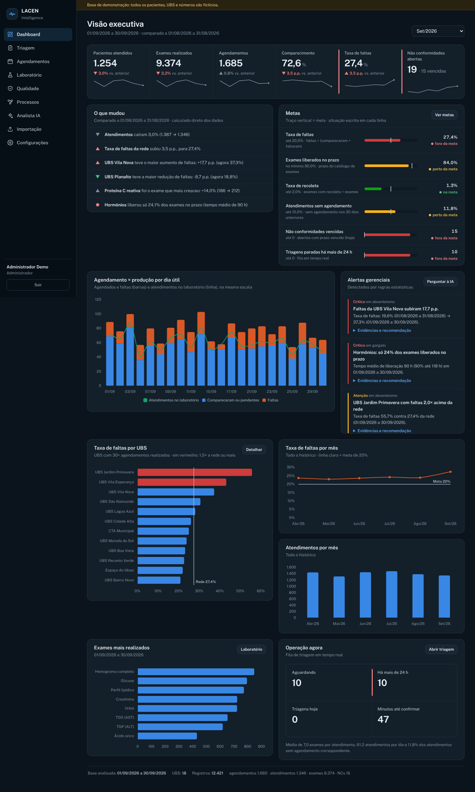
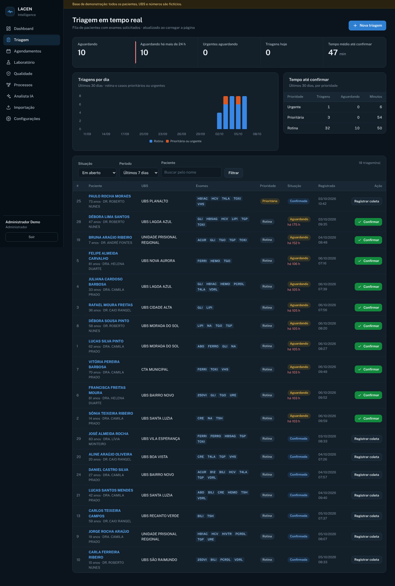
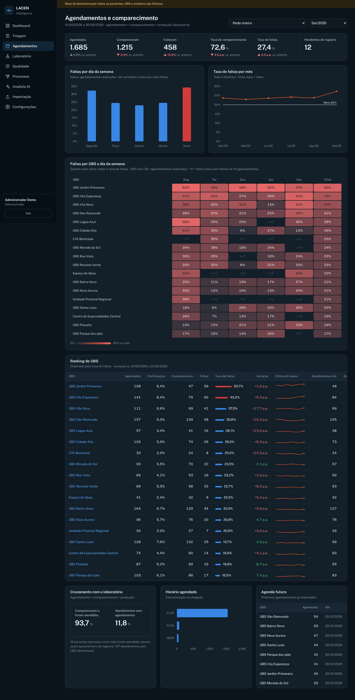
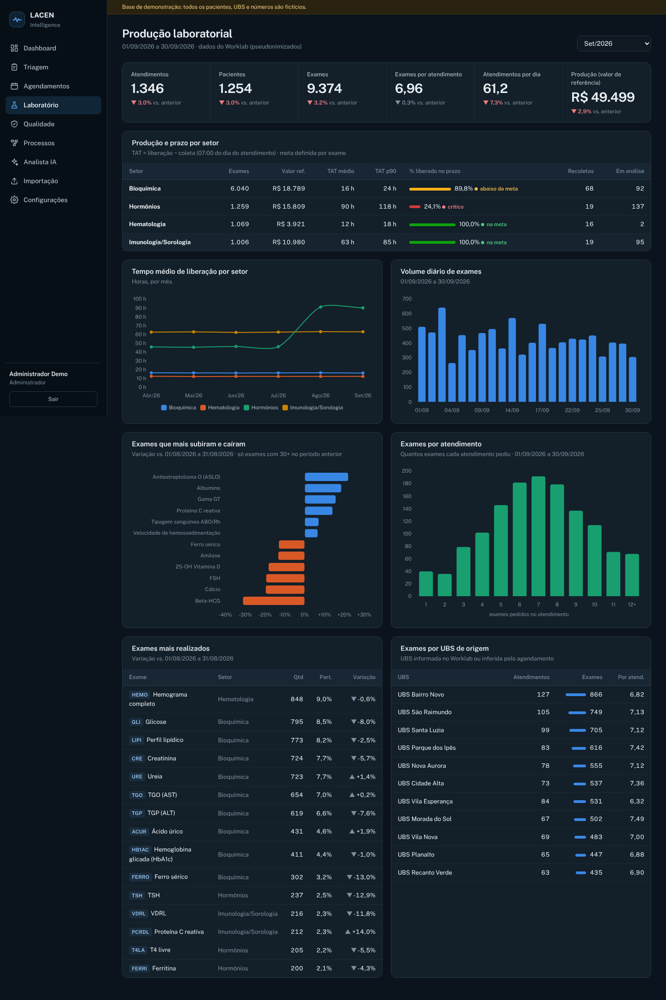
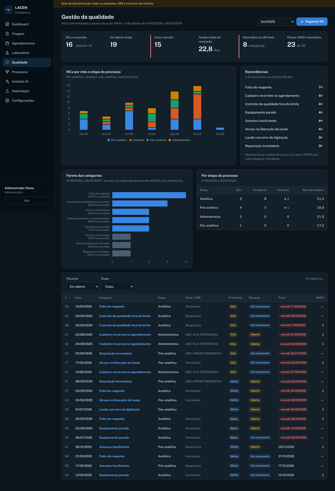
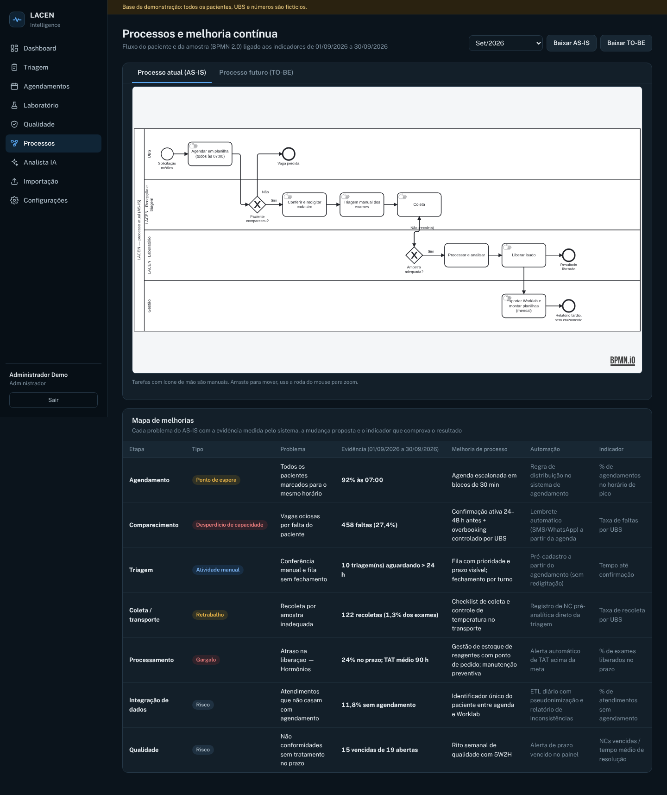
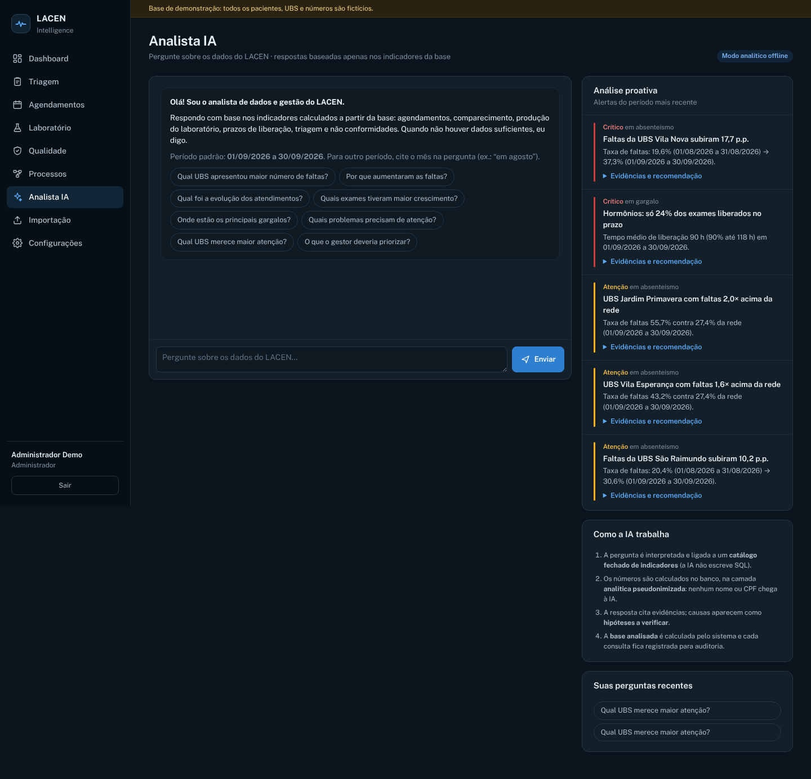

# LACEN Intelligence

**Plataforma de inteligência gerencial para laboratório.** Integra triagem, agendamentos das UBS,
produção laboratorial (Worklab), qualidade, processos, BI e um analista de IA que responde **apenas
com o que os dados mostram**.

> Gestão + Processos + Dados + Tecnologia + BI + IA



## O que o sistema faz
```
Triagem → Importação (ETL) → PostgreSQL → Indicadores → Alertas → Analista IA / Power BI → Decisão → Plano 5W2H
```
| Módulo | Destaques |
|---|---|
| **Dashboard** | KPIs com variação vs. mês anterior, alertas estatísticos, ranking de UBS, evolução mensal |
| **Triagem** | Cadastro com validação de CPF, fila priorizada, confirmação/coleta auditadas, CPF sempre mascarado |
| **Agendamentos** | Faltas por UBS, dia e horário; cruzamento agendamento × comparecimento × produção |
| **Laboratório** | Produção por setor, tempo de liberação (TAT), % no prazo, recoletas, exames em alta |
| **Qualidade** | Não conformidades por etapa, reincidência, prazos vencidos e plano de ação 5W2H |
| **Processos** | BPMN 2.0 AS-IS/TO-BE e mapa de melhorias com evidência medida |
| **Analista IA** | Perguntas em português, respostas com evidência, base analisada e "não há dados suficientes" quando for o caso |
| **Importação** | CSV/Excel → validação → padronização → pseudonimização → banco, com relatório por linha |

## Rodando

### Com Docker
```bash
cp .env.example .env              # preencha FLASK_SECRET_KEY e PSEUDO_SECRET
docker compose up -d --build
docker compose exec app python -m scripts.demo   # base de demonstração fictícia
# http://localhost:8000  ·  admin@lacen.demo / Lacen@2026
```

### Sem Docker
```bash
python -m venv .venv && source .venv/bin/activate     # Windows: .venv\Scripts\activate
pip install -r requirements-dev.txt
cp .env.example .env                                   # ajuste DATABASE_URL para seu Postgres
python -m scripts.demo                                 # cria tabelas + dados fictícios
flask --app wsgi run                                   # http://localhost:5000
pytest                                                 # 35 testes (usa o banco lacen_teste)
```

### Supabase (inclusive o projeto do TCC)
1. Supabase → botão **Connect** → *Session pooler* → copie a URI. Em `DATABASE_URL`, troque
   `postgresql://` por `postgresql+psycopg://` e coloque a senha do banco no lugar de `[YOUR-PASSWORD]`.
2. `python -m scripts.demo` (detecta o Supabase e **não apaga nada**). Na primeira execução, as tabelas
   antigas do TCC com o mesmo nome (pacientes, triagens, exames, usuarios, medicos) são **movidas para o
   schema `legado_tcc`**, com os dados intactos e o acesso público fechado. Para não carregar a
   demonstração, use `python -m scripts.migrar`.
3. Em Settings → API, **não** exponha os schemas `analitico` e `legado_tcc`.

### Ativar a IA generativa
Coloque `GEMINI_API_KEY` (Google AI Studio) ou `ANTHROPIC_API_KEY` no `.env` — o Gemini tem prioridade.
Sem chave, o Analista funciona no **modo analítico offline**, com as mesmas ferramentas e a mesma estrutura
de resposta. Em qualquer modo a IA só recebe indicadores agregados (nunca nome, CPF, CNS ou pseudônimo).

## Importando dados reais
- Pela tela **Importação**, ou por linha de comando:
  `python -m etl.cli agendamentos arquivo.xlsx` · `python -m etl.cli worklab export.csv --criar-ubs`
- O painel Power BI antigo: `python -m scripts.importar_pbix "Painel_UBS_Worklab.pbix"`
- Painel Power BI novo: `python -m scripts.exportar_powerbi` e abra `powerbi/LACEN_Intelligence.pbip`
- **Use um banco separado para dados reais** e `BASE_DEMO=0`.

## Documentação
- [Estudo de caso para portfólio](docs/PORTFOLIO.md)
- [Arquitetura e modelo de dados](docs/ARQUITETURA.md)
- [Catálogo de indicadores e regras de alerta](docs/INDICADORES.md)
- [Power BI: painel pronto (PBIP), modelo, DAX e páginas](docs/POWERBI.md)
- [Segurança e LGPD](docs/SEGURANCA_LGPD.md)
- Diagramas BPMN: `app/static/bpmn/processo_atual.bpmn` e `processo_futuro.bpmn` (abrem no Camunda Modeler/bpmn.io)

## Telas
| | |
|---|---|
|  |  |
|  |  |
|  |  |

## Roadmap
- [x] Fase 1–2: análise do projeto anterior, banco (schema, views, RLS, auditoria)
- [x] Fase 3–5: ETL com anonimização; agendamentos e Worklab integrados
- [x] Fase 6: catálogo de indicadores e dashboard
- [x] Fase 7: camada analítica e painel Power BI pronto (PBIP: TMDL + PBIR)
- [x] Fase 8: qualidade (NC + 5W2H)
- [x] Fase 9: Analista IA (Claude tool use + offline) e alertas proativos
- [x] Fase 10–11: testes automatizados, Docker
- [ ] Próximos: Supabase Auth, ETL agendado (cron) lendo uma pasta/SFTP do Worklab, alertas por e-mail,
      resultados/TAT vindos diretamente do Worklab, deploy (Render/Fly.io + Supabase)

---
Base de demonstração 100% fictícia. Nenhum dado de paciente real está neste repositório.
