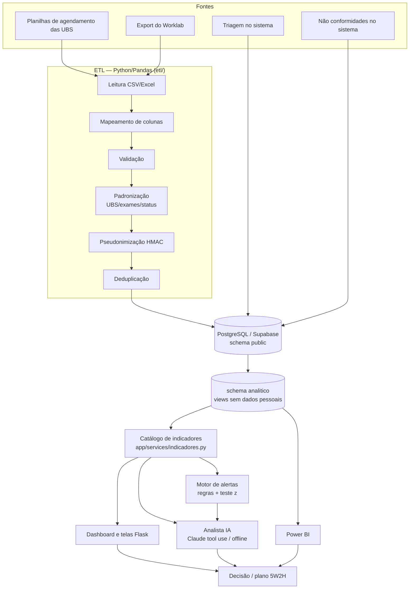
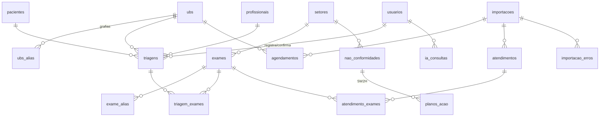

# Arquitetura



## Estrutura de pastas
```
app/
  __init__.py          fábrica Flask, filtros, tratamento de erros
  config.py, db.py     configuração e acesso ao Postgres (SQLAlchemy Core)
  seguranca.py         login, perfis, CSRF, cabeçalhos, mascaramento
  blueprints/          uma rota por módulo (triagem, agendamentos, laboratorio, ...)
  services/
    indicadores.py     única fonte de números
    alertas.py         regras de alerta
    analista/          ferramentas, modo LLM, modo offline
  templates/, static/  interface (CSS próprio, Chart.js, bpmn-js locais)
etl/                   normalização, anonimização, importador, CLI
db/migrations/         001 schema · 002 analítico · 003 segurança/RLS
db/seeds/              catálogo de exames
scripts/               migrar, demo, importar_pbix, exportar_powerbi, gerar_bpmn
tests/                 35 testes (ETL, indicadores, IA, web)
docs/                  esta documentação
```

## Modelo de dados



`agendamentos` e `atendimentos` se ligam **pelo pseudônimo do paciente** (`paciente_pseudo`), não por
chave estrangeira. O cruzamento é feito nas views `analitico.fato_agendamentos` (atendido no laboratório
em até 7 dias) e `analitico.fato_atendimentos` (UBS inferida pelo último agendamento em até 30 dias,
quando o Worklab não informa a UBS).

## Decisões técnicas
| Decisão | Motivo |
|---|---|
| Manter Flask (não FastAPI) | O site original já era Flask e renderiza HTML no servidor |
| SQLAlchemy Core em vez de supabase-py | Transações, carga em lote, views e o mesmo código em Postgres local ou Supabase |
| Regras de negócio em views SQL | Power BI, dashboard e IA usam a mesma definição |
| Autenticação própria (bcrypt) | Funciona igual em local/Docker/Supabase; migrar para Supabase Auth é um passo futuro |
| Bibliotecas JS no projeto (não CDN) | CSP `script-src 'self'` e funcionamento sem internet externa |
| IA com catálogo fechado de ferramentas | Elimina SQL gerado por modelo e acesso a dados pessoais; garante números corretos |
